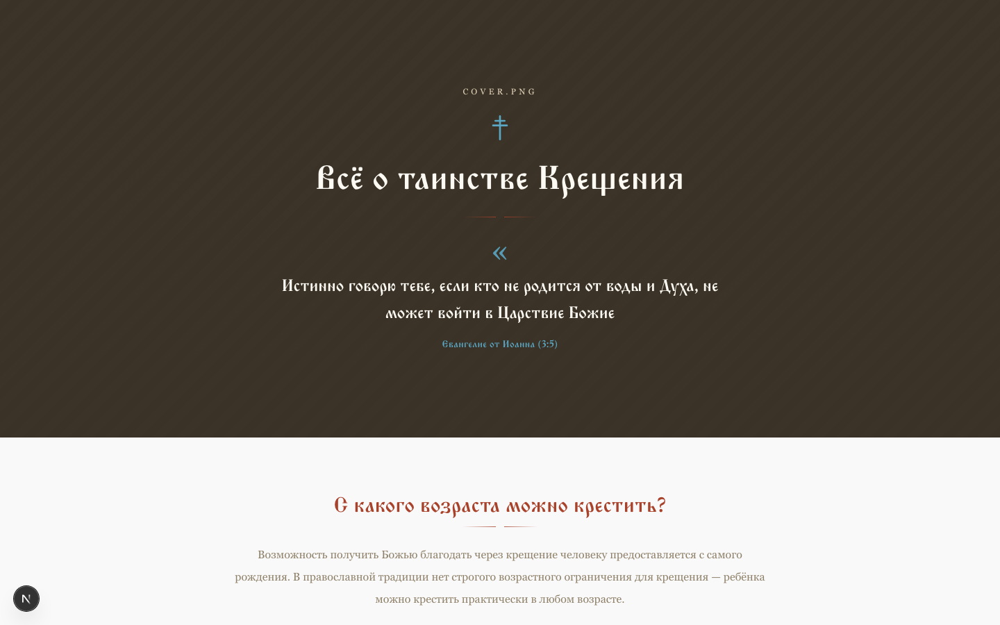
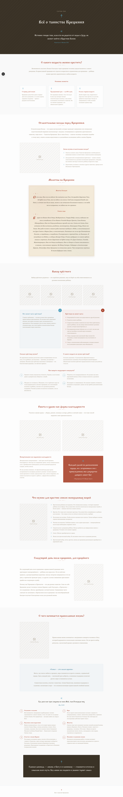

# Всё о таинстве Крещения

Статический landing page о таинстве Крещения в православной традиции: возраст крещения, огласительные беседы, выбор крёстного, молитвы, необходимые вещи и первые шаги в церковной жизни. Собран на Next.js (App Router, статический экспорт) с оформлением в традиционном православном стиле.

## Скриншоты

**Заглавный экран**



**Полная страница (десктоп)**



**Мобильная версия**


## Технологии

- [Next.js](https://nextjs.org) (App Router, `output: "export"` — статический сайт)
- TypeScript, Tailwind CSS
- Шрифт [Monomakh](https://fonts.google.com/specimen/Monomakh) через `next/font/google`

## Запуск локально

```bash
npm install
npm run dev
```

Открыть [http://localhost:3000](http://localhost:3000).

## Статическая сборка

```bash
npm run build
```

Собранный сайт появится в папке `out/` — его можно разместить на любом статическом хостинге.

## Заметки

Изображения (`cover.png`, `katehezis.png`, `krestniy1-4.png`, `man-labor.png`, `woman-labor.png`, `baptise-kit.png`, `holy-comunion.png`, `orthodox-life.png`) пока не добавлены — на их месте временные плейсхолдеры с подписанными именами файлов. Чтобы подключить реальные изображения, положите их в `public/images/` и замените компоненты `ImagePlaceholder` в [`src/app/page.tsx`](src/app/page.tsx) на `next/image`.
